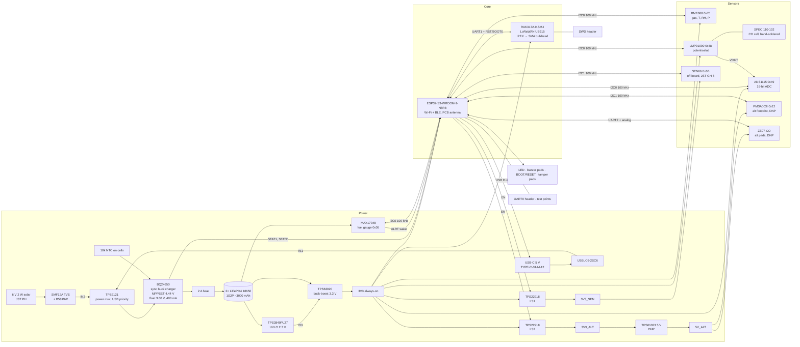

# Sylvia Node Tier B: block diagram

Rails: **VBAT** (1S2P LiFePO4, 2.5–3.65 V) → **3V3** (always on) → **3V3_SEN** (switched, SEN66) and
**3V3_ALT → 5V_ALT** (switched + DNP boost, only for the PMSA003I / ZE07-CO alternates).
Two I2C buses, both at 100 kHz (LMP91000 and SEN66 limits): **I2C0** on-board, always powered; **I2C1** to the SEN66 cable,
with its pull-ups on 3V3_SEN so a powered-down sensor is never back-fed through SDA/SCL.

## Why it looks like this
- **Always-on CO front end.** The electrochemical cell needs continuous bias: LMP91000 + ADS1115 together draw
  ~10 µA, so gating them saves nothing and would cost minutes of re-stabilisation per wake. The plan's "load switch
  for the CO front end" is used for the **CO alternate rail** (ZE07-CO) instead; a fitted 0 Ω jumper still isolates
  the LMP91000/ADS1115 for bring-up.
- **Cheap sensors trigger the expensive one.** CO and BME688 run every 60 s for microwatts; the SEN66 (~90 mA,
  30 s start-up) is sampled every 5/15 min and runs continuously only when CO or gas resistance moves (detector burst).
- **Wi-Fi first, LoRaWAN second.** Wi-Fi MQTT carries full JSON; the RAK3172 only sends the 11-byte payload when
  Wi-Fi or home power is down.
- **No 5 V on the default build.** Everything runs at 3.3 V; the 5 V boost exists only for the alternates.
